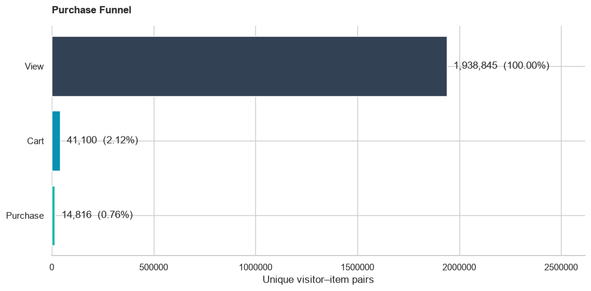
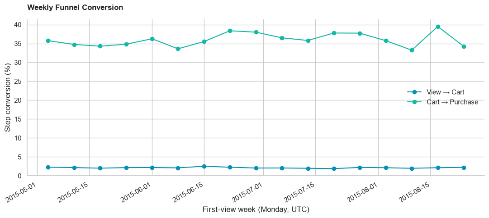
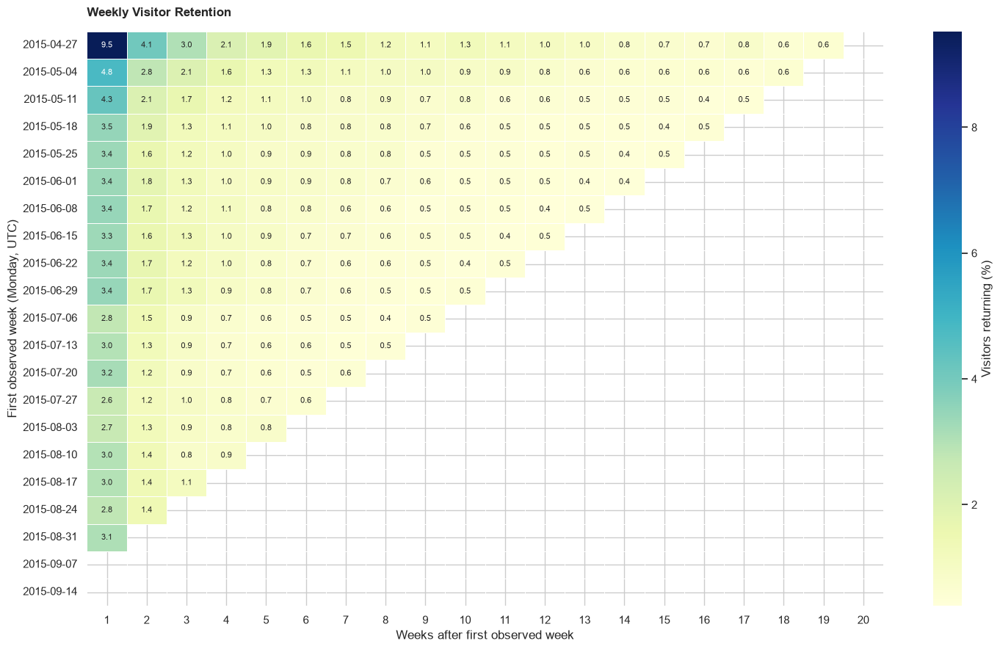
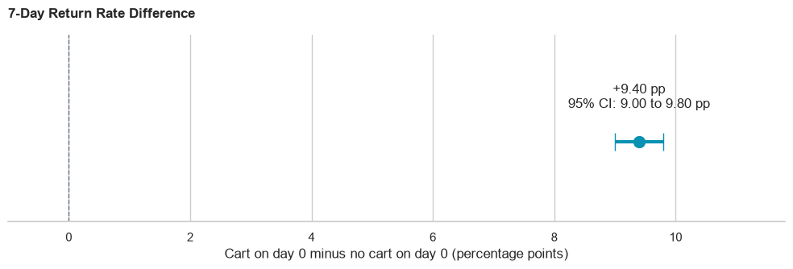

# 97.88% of Eligible Product Views Did Not Reach Cart

## Customer Journey and Retention Analysis

SQL and Python analysis of Retailrocket ecommerce events to identify funnel drop-off, track weekly visitor retention, and compare return rates by first-day cart activity.

### Main findings

| Finding | Result |
|---|---|
| View to cart | 41,100 / 1,938,845 eligible visitor-item pairs: **2.12%** conversion |
| Cart to purchase | 14,816 / 41,100 cart pairs: **36.05%** conversion |
| Full funnel | **0.76%** of eligible viewed pairs reached purchase |
| Weekly consistency | View-to-cart was the lower-converting step in **17 of 17** complete eligible weeks |
| Weekly retention example | May 4 cohort: about **4.8%** returned in week 1, **2.8%** in week 2 and **1.6%** in week 4 |
| Days 1-7 return | First-day cart visitors: **15.03%**; others: **5.63%** |
| Return-rate difference | **+9.40 percentage points**, 95% CI **[9.00, 9.80]**, two-sided **p < 0.001** |

The headline uses one first observed product view per eligible visitor-item pair, rather than all raw view events. The return-rate comparison is observational: it does not establish that adding to cart causes return visits.

### Charts



Labels above are percentages of all eligible viewed pairs.





The first cohort is a partial entry week; blank cells indicate incomplete follow-up. Values are percentages rounded to one decimal place.



### Data

Source: [Retailrocket recommender system dataset on Kaggle](https://www.kaggle.com/datasets/retailrocket/ecommerce-dataset), published by Retailrocket. The publisher describes anonymized activity collected from a real ecommerce website. Its Kaggle data card lists [CC BY-NC-SA 4.0](https://creativecommons.org/licenses/by-nc-sa/4.0/).

Only `events.csv` is used. Raw data and the derived database are not included. Charts and aggregates are derived from that source, with exact duplicate records removed as described below. Retain source attribution and the applicable dataset license when reusing derived material.

| Field | Meaning |
|---|---|
| `timestamp` | Unix milliseconds |
| `visitorid` | Anonymous visitor identifier |
| `event` | `view`, `addtocart`, or `transaction` |
| `itemid` | Anonymous product identifier |
| `transactionid` | Transaction identifier; absent for view/cart events |

Observed coverage: **2015-05-03 03:00:04.384 UTC to 2015-09-18 02:59:47.788 UTC**. The event file contains 2,756,101 rows. It has no prices, campaign exposures or experiment assignments used in this analysis.

### Cleaning

- No missing values in the four required event fields; no purchase event missing its transaction ID.
- Removed **460 exact duplicates** across the five original fields, retaining one copy. This assumes identical records are duplicate logs; the data does not prove this.
- **2,755,641 rows** remain: 2,664,218 views, 68,966 cart events and 22,457 purchase events.
- Missing transaction IDs remain NULL. The source CSV is unchanged.
- SQLite has an index on `(visitorid, itemid, timestamp)`.

### Metric definitions

**Ordered funnel:** one row per visitor-item pair, anchored to its first observed view. Require that view to be at least 14 elapsed days before the final observed event. A cart must occur strictly after the view and within 7 elapsed days; a purchase must occur strictly after a valid cart and within another 7 elapsed days. Upper limits are inclusive. Equal timestamps do not prove event order.

For repeated carts, select the earliest qualifying cart leading to a qualifying purchase; otherwise select the earliest qualifying cart. View-to-cart divides by all eligible viewed pairs. Cart-to-purchase divides by those eligible pairs reaching cart. Overall conversion divides purchased pairs by viewed pairs. Drop-off is 1 minus the relevant step conversion. Purchases without an observed qualifying view/cart sequence are excluded from this funnel; purchased pairs are not unique orders.

**Weekly conversion:** group the same funnel by first-view week. Weeks start Monday in UTC. Retain full entry weeks whose entire 7-day interval has the required 14-day follow-up. This produces 17 weeks, starting May 4 through August 24. Boundary weeks can contribute to the overall funnel while being excluded from the weekly chart.

**Cohort retention:** cohort = first observed event's Monday week, using any event type. For each subsequent calendar week, count distinct active visitors divided by the original cohort size. Returns can occur in multiple weeks. This is periodic, not cumulative retention. Incomplete weeks remain NaN. The cohort labeled April 27 has only May 3 entry observations and should not be compared directly with full entry cohorts. The final rows have no complete return week yet.

**Return comparison:** A added to cart on the same UTC day as first observation; B did not. Return means any event during calendar days 1-7 after that day. Include visitors only when day 7 finishes before the final partial data day, September 18. Eligible first days end September 10. A contains 30,761 visitors and 4,623 returners; B contains 1,315,712 visitors and 74,108 returners. Groups are disjoint, with one outcome per visitor. The two-sided pooled two-proportion z-test checks equal rates; a Newcombe interval estimates A minus B. Both groups have adequate observed return/non-return counts for the normal approximation. A displayed numerical p-value of zero in the original execution was floating-point underflow; it is reported as p < 0.001.

### Run locally

1. Download `events.csv` from the source and put it in `Data/`.
2. Use Python 3.12 in your project environment. Install dependencies:
   ```bash
   python -m pip install -r requirements.txt
   ```
3. From this project folder, run:
   ```bash
   jupyter notebook
   ```
4. Open `customer_journey_analysis.ipynb` and run cells from top to bottom. The notebook creates `Data/customer_journey.db`, rebuilds its derived tables, and saves the charts to `figures/`.

`analysis.sql` contains the same ordered funnel and a complete-week SQL summary. Run it against the cleaned `events` table created by the notebook. Cohort calculations, hypothesis testing and plotting remain in Python. The notebook is self-contained and does not need to load the SQL file.

The recorded analysis used statsmodels **0.15.0**; Python 3.12 was the environment setup target. Exact versions of the remaining installed packages were not captured in the uploaded notebook. `requirements.txt` lists compatibility ranges, not an exact environment lock. To record the local environment, run `python -m pip freeze > environment_versions.txt` in the activated project environment.

### Files

| File | Purpose |
|---|---|
| `customer_journey_analysis.ipynb` | Code, definitions and saved executed outputs |
| `analysis.sql` | Funnel construction and weekly SQL summary |
| `reports/analysis_story.md` | Business findings and three proposed actions |
| `figures/` | Four charts extracted from saved notebook outputs |
| `requirements.txt` | Python dependencies |
| `Data/README.md` | Local data placement |

### Limits and validation

First observation is not necessarily acquisition; browser IDs may not map one-to-one to people. Observation-window rules reduce end-of-file censoring but do not establish uninterrupted tracking. The first and final UTC days are partial. The source cautions about abnormal users; no bot/abnormal-user filter was applied, so unusual activity may influence results. Event order and 7-day windows are analytical choices, not the retailer's documented business rules. No session, device, geography, channel or product-category adjustment was performed. Historical 2015 ecommerce behavior is not evidence of current Dubai or Gulf conversion benchmarks.

The uploaded notebook's executed outputs support the reported results. Packaging checks covered Python syntax, saved error outputs, figure presence and SQLite funnel fixtures for repeated carts, item matching, equal timestamps, window limits and eligibility. The full raw dataset was not available in the packaging workspace, so no independent full-data rerun is claimed.
